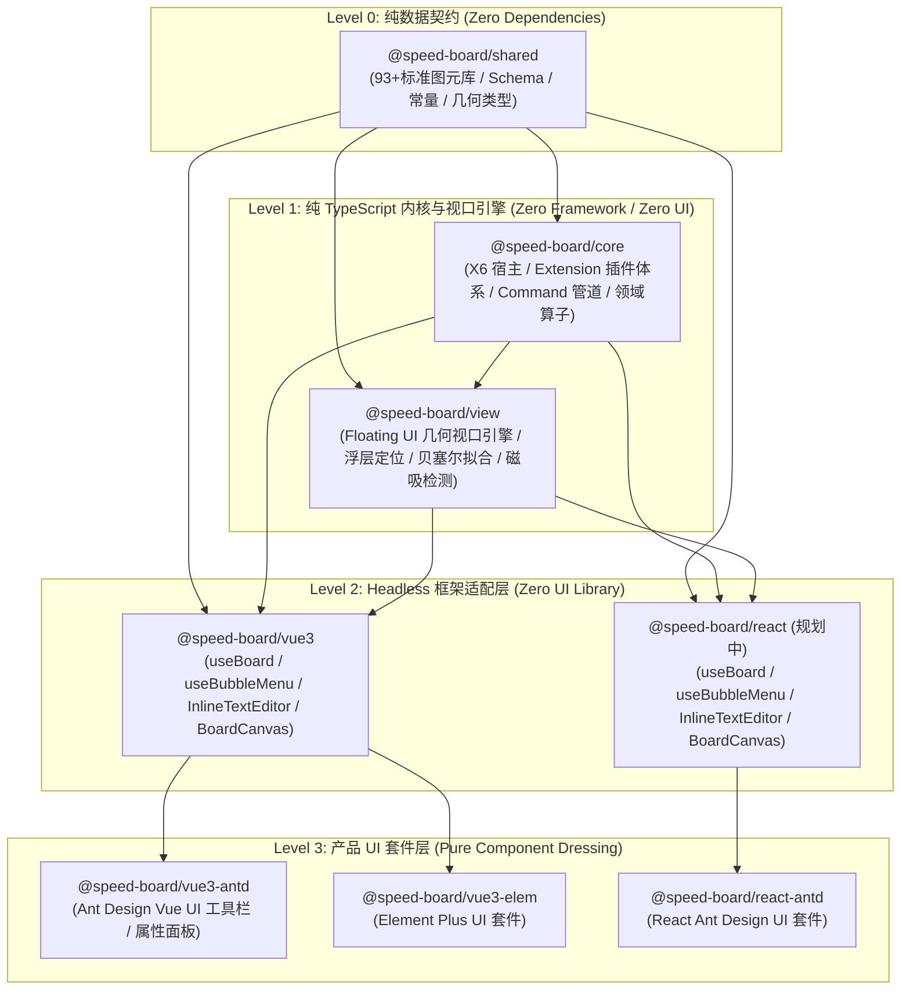
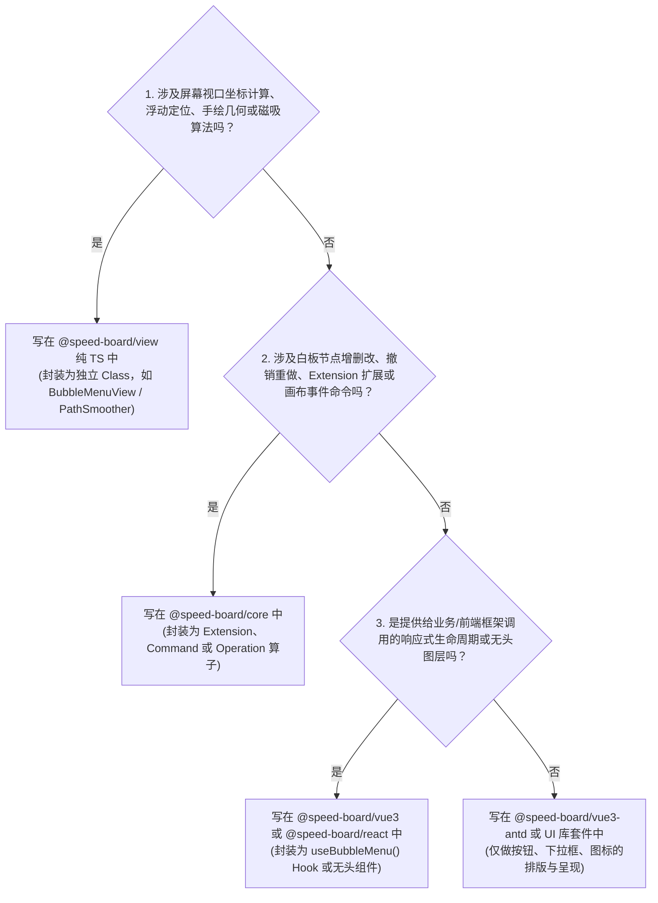

# Speed-Board 跨框架与跨 UI 库架构约束规范 (Architectural Constraints)

> **目标**：确保 `speed-board` 在后续迭代、图元扩展以及生态衍生中，**核心内核与交互算法 100% 独立于前端框架（Vue / React）与 UI 组件库（AntD / Element / Semi / Tailwind）**，杜绝胶水代码乱飞与逻辑揉合。

---

## 一、 核心设计原则 (Core Principles)

1. **框架无关优先 (Framework-Agnostic First)**
   * 所有几何坐标变换、视口投影、浮层绝对定位、手绘平滑贝塞尔、连接桩磁吸、选区状态机、撤销重做算子，**必须先以纯 TypeScript（Vanilla TS）编写**。
   * 严禁在 `@speed-board/core` 和 `@speed-board/view` 中引入任何 `vue`、`react` 或具体的 UI 库。

2. **单一可信源与声明式调度 (Single Source of Truth & Declarative)**
   * 对标 Tiptap / ProseMirror 的成熟架构：浮层工具栏、气泡菜单等交互的显示与隐藏，必须由**统一声明式的 `shouldShow(context)` 纯函数**驱动，严禁在多层 Vue/React 模板中层层嵌套 `v-show` 或散落多个独立的布尔 `ref` 互搏。

3. **三层物理隔离架构 (Three-Tier Decoupled Layering)**
   * **内核与视口层 (Core & View)**：纯 TS 驱动逻辑与数学计算；
   * **无头框架适配层 (Headless Adapter)**：极薄的响应式胶水（Vue `ref` / React `useRef` + `useState`）；
   * **产品 UI 套件层 (UI Suite)**：纯粹的皮肤组装（Button、Dropdown、Panel）。

---

## 二、 包分层职责边界与依赖隔离规则 (Package Boundary Matrix)



### 依赖红线检查表：

| 目录包 | 职责定义 | 允许依赖 | 严禁依赖 (违规者 CI 拦截) |
| :--- | :--- | :--- | :--- |
| **`packages/shared`** | 纯数据定义、93个图元库、Schema、常量 | 无任何依赖 | 严禁依赖任何外部运行时 |
| **`packages/core`** | 纯 TS 白板内核、Extension/Command 管道 | `@speed-board/shared`, `@antv/x6`, `yjs` | **严禁依赖 `vue`, `react`, `@floating-ui`, 任何 UI 库** |
| **`packages/view`** | 纯 TS 视口、浮动计算、几何吸附、平滑算子 | `@speed-board/shared`, `@speed-board/core`, `@floating-ui/dom` | **严禁依赖 `vue`, `react`, 任何 UI 库** |
| **`packages/vue3`** | Vue 3 Headless 适配层，无任何样式和 UI 库 | `@speed-board/*` (除 UI 库外), `vue` | **严禁依赖 Ant Design, Element, Less/Sass** |
| **`packages/react`** | React Headless 适配层，无任何样式和 UI 库 | `@speed-board/*` (除 UI 库外), `react` | **严禁依赖 Ant Design, MUI, CSS 库** |
| **`packages/vue3-antd`** | Ant Design Vue 皮肤与开箱即用套件 | 全部内部包, `ant-design-vue`, `less` | 只做组装，不包含核心视口数学与图元业务算法 |

---

## 三、 “功能写在哪？” 开发决策树 (Feature Decision Tree)

当你要实现一个新的功能（如：浮动工具栏、思维导图新交互、智能连线桩、属性面板）时，请按顺序回答以下问题：



---

## 四、 核心场景标准范式 (Reference Patterns)

### 范式 1：浮动气泡菜单模式 (BubbleMenu Pattern，对标 Tiptap)

严禁在 Vue 组件内部手写复杂的 Floating UI 计算和多重监听。统一遵循三层标准范式：

#### 1. View 层控制器（纯 TS，`packages/view/src/overlay/bubble-menu.ts`）：
```typescript
// 纯 TS 控制器，无任何框架代码，负责计算几何包围盒与调度 shouldShow
export class BubbleMenuView {
  constructor(options: BubbleMenuViewOptions) { ... }
  public updatePosition(): Promise<void> { ... }
  public setIsTyping(typing: boolean): void { ... }
  public destroy(): void { ... }
}
```

#### 2. Vue 3 适配层（`packages/vue3/src/composables/useBubbleMenu.ts`）：
```typescript
// 极薄的响应式包装：仅将 TS 控制器映射至 Vue 响应式系统
export function useBubbleMenu(options: UseBubbleMenuOptions) {
  const menuRef = ref<HTMLElement | null>(null)
  const visible = ref(false)
  // 实例化底层框架无关的 BubbleMenuView
  const view = new BubbleMenuView({ ... })
  return { menuRef, visible, currentType, updatePosition }
}
```

#### 3. React 适配层（规划中的 `@speed-board/react`，100% 复用核心）：
```typescript
// React 侧使用同一个 BubbleMenuView，代码仅需 30 行
export function useBubbleMenu(options: UseBubbleMenuOptions) {
  const menuRef = useRef<HTMLElement>(null)
  const [visible, setVisible] = useState(false)
  useEffect(() => {
    const view = new BubbleMenuView({ element: menuRef.current, ... })
    return () => view.destroy()
  }, [options.board])
  return { menuRef, visible }
}
```

#### 4. UI 呈现层（`packages/vue3-antd`）：
```html
<template>
  <div v-show="visible" ref="menuRef" class="bubble-toolbar">
    <!-- 纯粹渲染 Ant Design 图标按钮，0 几何计算代码 -->
  </div>
</template>
<script setup>
const { menuRef, visible, currentType } = useBubbleMenu({ board, isTyping })
</script>
```

---

## 五、 反模式审查清单 (Anti-Patterns Checklist)

在提交 Pull Request 或添加新功能时，必须对照以下清单检查，命中任意一条均判定为架构违规：

- [ ] **❌ 严禁在 Vue/React 模板中针对同一个浮层叠加双重显示控制**
  * *反模式*：父层写 `v-show="!isTyping"`，子组件内部又写 `v-show="visible"`。
  * *正例*：统一通过 `useBubbleMenu` 声明式 `shouldShow: ({ isTyping, selectedCells }) => ...` 单一源控制。

- [ ] **❌ 严禁直接读取带有透明 SVG 背景或下划线元素的 DOM `getBoundingClientRect()`**
  * *反模式*：`view.container.getBoundingClientRect()`（Chromium 会忽略透明 rect，导致高度坍塌、浮层落到斜下角）。
  * *正例*：统一走 X6 几何模型 `board.graph.localToClient(node.getBBox())` 计算精确视口矩形。

- [ ] **❌ 严禁在 `@speed-board/core` 或 `@speed-board/view` 中使用 `ref`, `reactive`, `useState`, `useEffect`**
  * *正例*：底层仅使用原生事件订阅、发布者模式或回调函数，响应式只在适配层做桥接。

- [ ] **❌ 严禁在 UI 套件包（如 `vue3-antd`）中编写业务逻辑和坐标算法**
  * *正例*：UI 套件只做视图装配，任何算子、坐标变换、撤销命令必须封装在 `core` / `view` 中。

- [ ] **❌ 严禁失焦（`blur`）时未经判断强行执行 `cleanSelection()`**
  * *反模式*：打字失焦时直接清理选区，导致用户无法再点击浮层修改字号颜色。
  * *正例*：输入与选中是一体的（Selection 保持），仅在真正点击非图元画布空白处（`blank:mousedown`）时才清理选区。
