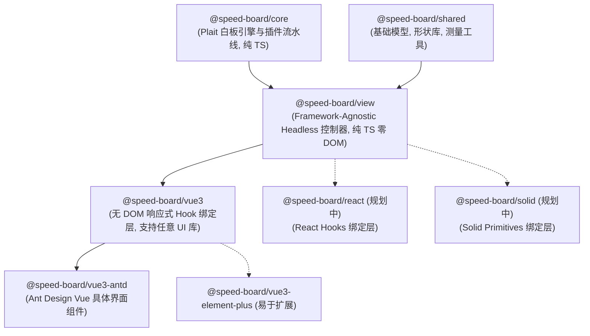

# SpeedBoard 现代化分层架构设计指南

SpeedBoard 采用面向多框架、无 DOM 耦合并高度可测试的**工业级分层架构**。从底层引擎到最外层 UI 组件，形成清晰的单向依赖流：



---

## 1. 架构分层职责与规范

### 1.1 `@speed-board/shared`（纯数据模型与几何工具库）
- **定位**：与框架、渲染引擎完全无关的纯工具库。
- **包含内容**：
  - 几何类型定义（Point, Rectangle, Box）。
  - 20+ 基础与扩展矢量图形库定义（`shapeLibrary`，包含 SVG 路径生成及 tight viewBox 计算）。
  - 文本测量工具与脑图节点尺寸预估算法（`textMeasure`）。
  - 调色板预设与默认样式常量。

### 1.2 `@speed-board/core`（白板引擎与流水线封装）
- **定位**：封装 `@plait/*` 底层引擎，暴露统一、易用的 `Board` 门面实例。
- **职责**：
  - 管理 Plait 画板生命周期（`createSpeedPlaitBoard`）。
  - 集成基础插件流水线（`withDraw`, `withMind`, `withFreehand`, `withHitEnhance`, `withPinchZoom`）。
  - 维护节点 WeakMap 索引（`NODE_TO_INDEX`, `NODE_TO_PARENT`），防止操作过程索引失效。
  - 统一操作指令：`insertShape`, `insertMindmap`, `insertLine`, `insertText`, `insertImage`, `setShapeProperty`, `undo`, `redo`。

### 1.3 `@speed-board/view`（无头交互控制器，Framework-Agnostic Headless View）
- **定位**：为 React / Vue / Solid 提供通用的无头业务逻辑，**纯 TS，零 DOM，零 UI 框架依赖**。
- **核心控制器**：
  - [`FloatingToolbarController`](file:///Volumes/ykxDrive/gitee/speed-platform/speed-board/packages/view/src/controllers/FloatingToolbarController.ts)：
    - 计算选中图元外接盒坐标并换算至宿主像素（`calculatePosition`）；
    - 提取当前浮动栏需要的样式属性状态（fill, stroke, 线型, 脑图布局, 箭头端点）；
    - 统一分发图层置顶/置底、对齐、成组、删除动作。
  - [`LineController`](file:///Volumes/ykxDrive/gitee/speed-platform/speed-board/packages/view/src/controllers/LineController.ts)：
    - 连线类型切换（折线 elbow / 直线 straight / 曲线 curve）；
    - 起点/终点端点预设库与切换（`arrowheadPresets`）；
    - 连线两端反向、连线中央文本读写。
  - [`NodeStyleController`](file:///Volumes/ykxDrive/gitee/speed-platform/speed-board/packages/view/src/controllers/NodeStyleController.ts)：
    - 提取和更新图形描边、填充、虚线、不透明度；
    - 提取和补丁更新节点富文本样式（字号, 粗体, 斜体, 对齐方式, 颜色）。
  - [`SelectionController`](file:///Volumes/ykxDrive/gitee/speed-platform/speed-board/packages/view/src/controllers/SelectionController.ts)：
    - 选区图元类型精准推断（`shape`, `line`, `text`, `image`, `mindmap-root`, `mindmap-node`, `multiple`, `none`）。
  - [`MindmapController`](file:///Volumes/ykxDrive/gitee/speed-platform/speed-board/packages/view/src/controllers/MindmapController.ts)：
    - 导图结构排版（标准两边、向右、向左、鱼骨图）；
    - 导图形状及图标/标记切换。
  - [`HistoryController`](file:///Volumes/ykxDrive/gitee/speed-platform/speed-board/packages/view/src/controllers/HistoryController.ts)：
    - 撤销/重做可用状态判断与执行。
  - [`ShapeController`](file:///Volumes/ykxDrive/gitee/speed-platform/speed-board/packages/view/src/controllers/ShapeController.ts)：
    - 保持原几何中心与样式的原地无缝形状切换。

### 1.4 `@speed-board/vue3`（无 DOM 的 Vue 3 响应式 Hook 绑定层）
- **定位**：使用 Vue 3 响应式系统（Ref, Computed, Watch）包装 `@speed-board/view` 控制器，**零 Ant Design 依赖**，可驱动任意 UI 界面。
- **提供 Hooks**：
  - `useBoard()`: 提供响应式 Board 实例注入与销毁。
  - `useBoardEvent(board, events, handler)`: 生命周期安全的画板事件侦听器。
  - `useBoardSelection(board)`: 响应式选区集合、图元类型及主选中元素。
  - `useFloatingToolbar(board)`: 响应式悬浮工具栏显示状态、坐标、样式动作。
  - `useLineOperations(board)`: 响应式连线属性与操作。
  - `useNodeStyle(board)`: 响应式样式抽屉与节点属性更新。
  - `useBoardHistory(board)`: 响应式 `canUndo` / `canRedo` 与触发方法。
  - `useCellAttributes(board, attr, default)`: 响应式图元字段侦听提取。
- **纯画布组件**：
  - `BoardCanvas.vue` / `PlaitBoard.vue`：无任何 UI 按钮的纯 SVG 容器宿主。

### 1.5 `@speed-board/vue3-antd`（具体的 Ant Design Vue UI 组件库）
- **定位**：具体的视觉呈现层，包含完整的开箱即用工作台与工具栏。
- **UI 组件矩阵**：
  - `SpeedBoard.vue`：白板主容器，组装 TopToolbar、LeftToolbar、FloatingToolbar、StyleSettingsPanel 与 BoardCanvas。
  - `TopToolbar.vue`：顶部操作栏（撤销、重做、缩放、图层开关、全屏、保存）。
  - `LeftToolbar.vue`：左侧悬浮胶囊工具栏（选区、抓手、图形库、脑图、连线、画笔、文本、图标、橡皮擦）。
  - `FloatingToolbar.vue`：贴合图元的 Tip Config 选区浮动工具栏。
  - `StyleSettingsPanel.vue`：右侧高级样式设置抽屉。
  - `ShapePickerPopover.vue` / `IconfontPopover.vue` / `ColorTonePicker.vue`：各弹出层选择器。

---

## 2. 后续扩展指南（以 React / Solid 为例）

得益于 `@speed-board/view` 的纯 TS 无头设计，若需支持 React 或 Solid，工作量极低（仅需编写薄包装层）：

```ts
// 伪代码：在 @speed-board/react 中实现 useFloatingToolbar
import { useState, useEffect } from 'react';
import { FloatingToolbarController } from '@speed-board/view';

export function useFloatingToolbar(board) {
  const [state, setState] = useState(() => FloatingToolbarController.extractProperties(board));
  useEffect(() => {
    if (!board) return;
    const sync = () => setState(FloatingToolbarController.extractProperties(board));
    board.on('selection:change', sync);
    board.on('change', sync);
    return () => {
      board.off('selection:change', sync);
      board.off('change', sync);
    };
  }, [board]);

  return {
    state,
    updateFill: (c) => FloatingToolbarController.updateFill(board, c),
    ...
  };
}
```
业务层即可用 MUI、Chakra UI 或 Tailwind 直接渲染，所有几何计算、连线端点、选区类型识别全部复用 `@speed-board/view`！
