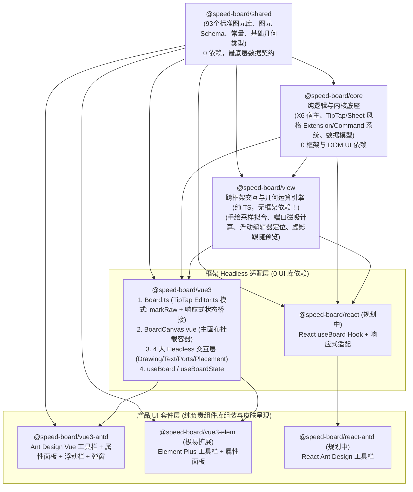

# Speed-Board 协同画板（白板/流程图）技术方案与架构设计

本文档总结自对语雀画板（Lakeboard）底层机制、渲染模型以及协同算法的深入调研，用于指导后续 `speed-board` 独立仓库/模块的开发落地。

---

## 一、 语雀画板（Lakeboard）核心技术机制剖析

### 1. 渲染架构：SVG + `<foreignObject>` 混合模式
- **图形与线条用 SVG 矢量渲染**：矩形、圆角椭圆、菱形、折线箭头等，缩放（0.1x - 5x）永不失真。
- **文字与富文本用 `<foreignObject>` 嵌入 HTML**：
  - 避免在 Canvas 中手工计算字号、行高、折行、对齐、富文本标签的巨大成本。
  - 直接在 SVG 内部承载 `<div style="...">富文本内容</div>`，样式排版完全复用浏览器原生 CSS 引擎。
- **底层原型推测**：阿里系图编辑框架 **AntV X6** / G6 规范，数据结构与节点锚点设计（`E/S/W/N`、曼哈顿折线路由）高度相似。

### 2. 坐标与定位系统
- **世界坐标系（World Coordinates）**：每个节点具备绝对逻辑坐标 `{ x, y, width, height, rotate, zIndex }`。
- **视口变换（Viewport Transform）**：
  $$\text{屏幕坐标} = (\text{世界坐标} - \text{视口左上角}) \times \text{Zoom}$$
  在根节点 `<g transform="matrix(zoom, 0, 0, zoom, tx, ty)">` 做全局硬件加速变换。
- **动态锚点与折线路由**：连线端点绑定到节点边界方位（如 `connection: "S"`），节点移动时动态更新连线起点终点，并由正交路由算法（Orthogonal Routing）计算折点。

---

## 二、 协同架构：CRDT / Yjs 接入方案

白板是**扁平实体模型（Entity Model）**，比起线性富文本（ProseMirror），它在 Yjs 上的映射更简单、几乎**天然 0 冲突**。

### 1. 数据结构设计
```typescript
import * as Y from 'yjs'

// 1. 文档根节点
const ydoc = new Y.Doc()

// 2. 所有图元（节点与连线）：Y.Map 以 ID 为 key
// yCells: Map<string, Y.Map<string, any>>
const yCells = ydoc.getMap('cells')

// 3. 协同状态（鼠标位置、选中框、用户头像）
// 走 y-protocols/awareness
```

### 2. Yjs 解决并发冲突机制
- **不同属性并发修改**：用户 A 改节点颜色，用户 B 同时拖拽位置 $\to$ 属性级自动合并，**0 冲突**。
- **同一属性并发拖拽**：用户 A 和 B 同时移动同一图形 $\to$ Yjs 基于 Lamport 逻辑时钟确定性胜出（LWW），两端无感收敛到同一坐标。
- **监听职责**：业务层**不需要编写任何冲突仲裁代码**，Yjs 触发更新时拿到的已经是最终合并好的数据，内核只负责将数据渲染到画布。

---

## 三、 整体系统分层架构（对标 speed-sheet 跨框架/跨UI库标准架构）



---

## 四、 项目目录结构（Monorepo）

```text
speed-board/
├── packages/
│   ├── shared/                    # 零依赖公共数据契约与资产包 (@speed-board/shared)
│   │   ├── src/
│   │   │   ├── types/             # geometry, nodes, interaction 基础契约
│   │   │   ├── shapes/            # 93 个全量标准矢量图元库 (SHAPE_GROUPS, 纯数据)
│   │   │   ├── constants/         # 调色盘预设、默认图形尺寸
│   │   │   └── index.ts
│   │   └── package.json
│   │
│   ├── core/                      # 纯 TypeScript 内核（0 框架依赖）
│   │   ├── src/
│   │   │   ├── Board.ts           # 核心控制器（调度中枢，语法糖别名代理到 commands）
│   │   │   ├── commands/          # TipTap 链式命令管理器 (CommandManager)
│   │   │   ├── extension/         # 插件抽象与官方内置插件 (history, clipboard, selection, shape)
│   │   │   ├── nodes/             # X6 自定义节点注册 (Shape, Text, Vector, Icon, Image)
│   │   │   ├── operations/        # 领域操作算子 (shapeOps, textOps, imageOps, layoutOps)
│   │   │   └── index.ts
│   │   └── package.json
│   │
│   ├── view/                      # 跨框架视口与交互数学引擎（纯 TS，0 框架依赖）
│   │   ├── src/
│   │   │   ├── draw/              # 贝塞尔平滑拟合 (path-smoother.ts)
│   │   │   ├── snapping/          # 边缘磁吸与对齐检测 (port-snapping.ts)
│   │   │   ├── overlay/           # 浮动编辑器定位、4向连接桩坐标投影、虚影布局
│   │   │   ├── types.ts           # 几何与交互通用类型定义
│   │   │   └── index.ts
│   │   └── package.json
│   │
│   ├── vue3/                      # Headless Vue 3 适配层（0 UI 库依赖）
│   │   ├── src/
│   │   │   ├── Board.ts           # TipTap Editor.ts 模式：markRaw + Vue 响应式状态桥接
│   │   │   ├── components/        # 4 大无 UI 依赖的 Headless 核心交互图层
│   │   │   │   ├── BoardCanvas.vue      # 画布挂载容器
│   │   │   │   ├── DrawingOverlay.vue   # 涂鸦/钢笔/连线实时预览捕获层
│   │   │   │   ├── InlineTextEditor.vue # 原地文本浮动输入框
│   │   │   │   ├── ShapeAnchorPorts.vue # 4 方向磁吸桩与延伸手柄
│   │   │   │   └── PlacementOverlay.vue # 鼠标跟随放置幽灵层
│   │   │   ├── composables/       # useBoard 等响应式 hook
│   │   │   └── index.ts
│   │   └── package.json
│   │
│   └── vue3-antd/                 # Ant Design Vue 产品 UI 组件层
│       ├── src/
│       │   ├── components/
│       │   │   ├── SpeedBoard.vue       # 开箱即用完整白板组件
│       │   │   ├── TopToolbar.vue       # 顶部工具栏 (a-button, a-dropdown)
│       │   │   ├── LeftToolbar.vue      # 左侧图元工具栏
│       │   │   ├── StyleSettingsPanel.vue # 属性设置面板 (a-input-number, 颜色选择器)
│       │   │   └── floatingToolbar/     # 节点选中浮动工具条
│       │   └── index.ts
│       └── package.json
│
├── demos/
│   └── vue3-demo/                 # 本地开发与联调 Demo
├── pnpm-workspace.yaml
└── package.json
```

---

## 五、 最小可行性版本（MVP）实施路线

新开会话开发时，按以下节奏推进：

1. **第 1 阶段：底座与 Yjs 联通（1~2 天）**
   - 搭建 Monorepo 工程结构与打包配置。
   - 封装 `Board` 基础类，挂载 AntV X6 画布。
   - 实现 `Board.ts` 的 `_initCollabSync()`：
     - 本地变更 $\to$ 写入 `yCells`。
     - 远程 `ydoc.on('update')` $\to$ 更新 X6 Cell，完成两人同时开网页双向同步。
2. **第 2 阶段：核心图元扩展（1 天）**
   - 实现 4 种常用基础形状：开始/结束（圆角椭圆）、矩形（流程）、菱形（判断）、折线带箭头（Elbow Edge）。
   - 实现节点文字双击编辑（`<foreignObject>` / 内联 input）。
3. **第 3 阶段：浮动操作条 Floating Tip（1 天）**
   - 监听 X6 选中事件 `cell:selected`，实时计算在屏幕坐标上的浮动位置。
   - 渲染浮动 Tip：支持改填充色、边框样式、删除、层级置顶。
4. **第 4 阶段：多人光标与高级功能（后续迭代）**
   - 接入 Awareness 多人鼠标光标与选择框跟随。
   - 泳道（Swimlane）容器与更多图元。
