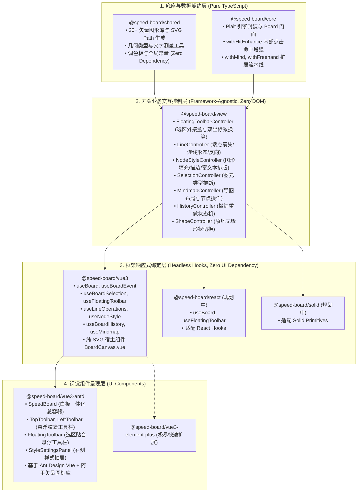

# SpeedBoard 现代原生白板引擎与分层架构

> 本分支（`feat/plait-migration`）记录了 SpeedBoard 彻底淘汰旧版 `@antv/x6` 架构，全面迁移至现代原生白板引擎 **Plait**，并落地面向多框架（Vue 3 / React / Solid）的工业级无头分层体系（Headless Architecture）的全过程。

[](https://github.com/whateveryoudo/speed-board/tree/feat/plait-migration)
[](https://opensource.org/licenses/MIT)

---

## 📌 为什么必须重构？（淘汰 X6 全面拥抱 Plait 的核心真相）

过去 SpeedBoard 基于 `@antv/x6` 开发。我们在旧架构上投入了大量心血进行功能攻坚，但越到后期，底层定位带来的**根本性缺陷**越发无法克服，尤其是**连线交互与路由避障**这一白板核心体验，成为了压垮旧架构的关键稻草。

### 1. 核心矛盾之首：连线交互的“血泪史”（旧版 X6 的挣扎 vs Plait 内置原生解法）

连线是白板最基础、最频繁的交互。我们在 X6 上花了极长时间反复调试优化，但最终实现依然很不完美、Bug 频出：

| 连线核心维度 | 旧版方案 (@antv/x6 的巨大代价与硬伤) | 新版方案 (Plait 内置的原生降维打击) |
| :--- | :--- | :--- |
| **矩形正交避障路由<br/>(Orthogonal / Manhattan Router)** | **极为脆弱的曼哈顿算法**：<br/>• X6 的 `router: 'manhattan'` 在节点移动、临近拖拽时频繁产生**折返死结、回旋圈、锯齿尖角、甚至斜向贯穿节点内部**；<br/>• 官方参数（`step`, `padding`, `maxDirections`）无论怎么微调，在复杂连线场景下依然会发生路径重叠与抽搐；<br/>• 为此我们手写外置路由补丁，但带来极高的计算卡顿与维护成本，依然实现不完美。 | **内置专用优雅正交折线算法**：<br/>• Plait 核心内置专用算法（`generateElbowLineRoute` 与 `simplifyOrthogonalPoints`）；<br/>• 原生兼顾起终点方向向量、包围盒外边距（`DEFAULT_ROUTE_MARGIN`）、自环（`isSelfLoop`）、图元相交与冗余折点化简；<br/>• 节点拖拽移动时，折线始终呈现教科书级工整的 90° 矩形直角避障，**完全无需业务层编写一行脆弱的路由补丁**！ |
| **边缘吸附与磁吸对齐<br/>(Adsorption & Snapping)** | **沉重繁琐的 DOM 桩位系统**：<br/>• X6 依赖庞杂的 Ports、Magnet 和 Anchor 机制；<br/>• 连线端点拖拽时吸附判定死板，经常发生“漏吸”、“吸附错位”或与节点拖拽事件冲突；<br/>• 移动图形时，连线端点经常断裂、漂移或异常吸附到节点几何中心，无法自然咬合轮廓。 | **几何感知吸附流水线**：<br/>• Plait 内置 `with-arrow-line-bound-reaction` 与 `with-arrow-line-create`；<br/>• 端点拖拽自动感知目标图元边缘的黄金分割点与轴心点，高精度磁吸吸附；<br/>• 移动图形时，连线端点原生自动响应联动（`boundReaction`），永远严密贴合图元边界。 |
| **连线形态平滑切换<br/>(Elbow / Straight / Curve)** | **销毁重构的破坏性切换**：<br/>• X6 中折线、直线、贝塞尔曲线由不同 Connector 和 Router 驱动，切换形态需销毁 Edge 实例或强行篡改底层几何模型，极易导致连线端点解绑、选区丢失与撤销重做（Undo/Redo）历史错乱。 | **单一模型的原位平滑切换**：<br/>• 折线（`elbow`）、直线（`straight`）、平滑曲线（`curve`）统一属于 `PlaitArrowLine` 标准数据模型；<br/>• 仅需调用一次 `board.setShapeProperty({ shape: type })` 即可原位无缝切换，吸附关系、箭头样式、文字完全无损保留。 |
| **连线居中文本与富文本** | **外挂 Label 浮层的割裂感**：<br/>• X6 连线文字依赖外置 Label 配置或 DOM 悬浮层，文字居中定位在折线拐弯时经常遮挡箭头或偏移出屏幕，且不支持内联富文本编辑。 | **原生 Slate 富文本集成**：<br/>• 连线文本直接集成 Slate.js，双击直接在连线中心原位打字编辑；<br/>• 连线折叠与弯曲时，文字自动随折线几何中心自适应平移，体验浑然一体。 |

---

### 2. 其他维度全面对比：为什么必须彻底放弃 X6？

除了连线交互这一核心痛点外，底层架构的本质差异同样决定了迁移的不可逆性：

| 维度 / 痛点 | 旧版 (@antv/x6 方案) | 新版 (Plait 原生白板方案) | 业务价值 |
| :--- | :--- | :--- | :--- |
| **产品定位** | **拓扑图 / 流程图引擎**<br/>专为有向无环图（DAG）连线拓扑设计，无法很好地适应大画布自由交互 | **现代原生自由协同白板引擎**<br/>专为无界自由白板打造，原生支持几何图形、思维导图、手绘自由混排 | 体验从“画流程图”质变为“现代化在线协同白板” |
| **渲染机制** | **重型 DOM 外挂 + `<foreignObject>`**<br/>节点大量依赖外挂 HTML 容器，画布缩放平移时产生亚像素抖动与层级闪烁 | **100% 纯原生 SVG Viewport 渲染**<br/>所有图元在单一 SVG 视口变换矩阵中高效绘制，零 DOM 外挂，缩放极其丝滑 | 渲染性能提升数倍，彻底杜绝浮层错位与性能瓶颈 |
| **富文本与编辑** | **割裂的外挂 input/textarea**<br/>双击编辑时动态叠加 HTML 元素，光标选区与节点属性分离，撤销重做无法原子化 | **原生 Slate.js 富文本原子集成**<br/>文字排版、光标、样式变更与节点本身数据流完全合一 | 原生富文本输入体验，支持细粒度排版与协同 |
| **思维导图与手绘** | **外置繁琐重算**<br/>导图结构增删需编写全量 recalculate；画笔受限于 SVG Path 更新，性能低 | **核心内置专用排版流水线**<br/>导图原生支持左右/鱼骨图等布局；手绘内置 Catmull-Rom 算法平滑拟合 | 导图拖拽排版与画笔绘制流畅顺手 |
| **依赖包袱** | **臃肿庞大**<br/>引入 230+ 个 X6 插件与兼容垫片，技术债务累累 | **纯净轻量**<br/>彻底移除 230+ X6 废弃依赖包，代码结构清爽可控 | 打包体积大幅缩减，依赖关系清晰健康 |

---

### 3. 底层攻坚踩坑复盘：图形中空点击选不中的根本原因与修复

在迁移初期，我们定位并彻底攻克了另一个隐蔽但致命的交互问题：**“在画布中画了一个图形，点击图形中间毫无反应，为什么必须精准点击 4px 的极细边框或通过框选才能选中？”**

#### ① 查阅 Plait 底层源码：CAD 时代的“中空穿透”哲学
查阅 Plait 官方核心源码 [`packages/draw/src/utils/hit.ts`](https://github.com/worktile/plait/blob/develop/packages/draw/src/utils/hit.ts#L217-L230)：
```ts
export const isHitDrawElement = (board, element, point, isStrict = true) => {
    // 1. 优先检测是否点中 4~5px 的边框边缘
    if (isHitEdgeOfShape(board, element, point, HIT_DISTANCE_BUFFER)) {
        return true;  // <--- 点中边框返回 true
    }
    
    // 2. 关键底层逻辑：在严格拾取模式下，没有文字且没有填充颜色的图形
    if (!!isStrict && isEmptyTextElement(element) && !isFilledDrawElement(board, element)) {
        return false; // <--- 只要点在图形内部空白处，底层直接拦截返回 false！
    }

    const engine = getEngine(getElementShape(element));
    return isHitText || engine.isInsidePoint(rectangle!, point);
};
```
在 Plait 核心类型定义中，官方作者专门留下了设计说明：
> `// When the element has no fill color, it is considered a hit only if it hits the border.`

官方作者沿用了传统 CAD / 矢量设计软件（如 Illustrator）中对待“线框（Wireframe）”的假设：**认为无填充、无文字的图形是透明中空的，中间点击应该直接穿透以选取背后的图元**。但这种设计严重违背了现代白板（Figma、Miro、Board）的用户直觉——**正常用户拖出一个矩形后，本能就是点击图形腹地正中心，不可能小心翼翼用鼠标对准 4px 细线点！**

#### ② 富文本未挂载时序 NPE Bug
此外，刚创建新图形时，Slate 文本编辑器尚未挂载到全局 WeakMap，`isEmptyTextElement` 内部调用 `editor.children[0]` 会抛出 `Cannot read properties of undefined (reading 'children')`，外层 catch 吞掉后直接判定未命中。

#### ③ 为什么框选又能中？
框选调用的是 `isRectangleHitDrawElement`，走的是包围盒相交几何检测，**完全不走严格中空判定，也不在乎是否有填充色或文字**，碰上即中！

#### ④ 优雅的修复方案：`withHitEnhance` 插件
我们在核心层中编写了 [`withHitEnhance`](packages/core/src/plait/with-hit-enhance.ts) 切片插件：
- 捕获并防御底层未初始化 NPE 异常；
- 当底层因“无填充无文字”直接返回 `false` 时，介入并调用 Plait 几何多边形包含算法 `board.isInsidePoint(element, point)`；
- 无论图形是否填色、是否有字，**只要点击点落在闭合几何轮廓内部，均立即判定为命中**，彻底解决了“必须瞄准边框点击”的反直觉问题！

---

## 🏗️ 全新项目架构图（Headless Multi-Framework）

SpeedBoard 彻底告别了过去“组件代码、DOM 操作、业务逻辑杂糅在一起”的单体模式，严格落地**工业级分层架构**，支持未来轻松扩展至不同 UI 库与前端框架：



### 各层职责分工表

| 包名 | 定位 | 技术特征 | 职责边界 |
| :--- | :--- | :--- | :--- |
| **`@speed-board/shared`** | 基础几何模型与资源库 | 纯 TS、零依赖 | 提供 20+ 矢量图形库（SVG Path）、文字测量工具、几何数学计算、预设调色板与常量。 |
| **`@speed-board/core`** | 原生白板引擎调度 | 纯 TS、零 DOM | 封装 Plait 底层实例为统一易用的 `Board` 门面；装载 `withHitEnhance`、`withMind` 等核心流水线插件；统一分发图元增删改指令。 |
| **`@speed-board/view`** | **跨框架无头控制器** | **纯 TS、零 DOM、零 UI 框架依赖** | **核心大脑**。纯数学和交互业务计算，包含双坐标系换算、样式状态提取、连线端点切换、导图排版、撤销重做判断。**未来无需重写任何逻辑，即可直接服务于 React 和 Solid**。 |
| **`@speed-board/vue3`** | **无 DOM 的响应式 Hook 绑定层** | 仅依赖 Vue 3 Composition API，**零 Ant Design 依赖** | 提供 `useBoard`、`useFloatingToolbar`、`useLineOperations`、`useNodeStyle` 等极薄响应式 Hooks 及纯 SVG 画布容器 `BoardCanvas.vue`。 |
| **`@speed-board/vue3-antd`** | 完整 Ant Design Vue 界面组件库 | 基于 Ant Design Vue 的视觉呈现层 | 提供开箱即用的白板工作台 `SpeedBoard`，顶部栏、左侧工具栏、贴合浮动工具栏及右侧样式抽屉。 |

---

## 🙏 开源生态致谢与指引

SpeedBoard 在重构过程中深度依托并借鉴了优秀的开源生态。在此向以下核心开源项目致以诚挚的感谢与崇高的敬意：

1. **[Plait (https://github.com/worktile/plait)](https://github.com/worktile/plait)**
   - **贡献与指引**：由 Worktile 团队开源的优秀多图元协同白板底座。提供了纯粹的 Immer 不可变数据流、Transforms 变换流水线、Slate.js 原生富文本绑定以及高质量的几何图形排版引擎。
   - **推荐阅读**：深入理解白板底座运作机制，建议研读其 `packages/core`、`packages/draw` 与 `packages/mind` 源码。

2. **[Drawnix (https://github.com/plait-board/drawnix/tree/develop)](https://github.com/plait-board/drawnix/tree/develop)**
   - **贡献与指引**：基于 Plait 打造的现代工业级开源白板应用。提供了高水平的手绘平滑拟合（Catmull-Rom）、悬浮工具栏属性提取规范及成熟的白板交互实践。
   - **推荐阅读**：进行白板界面设计与高级画笔、图片功能二次开发时，非常推荐参考其开源实现。

---

## 🚀 快速上手与本地调试

### 1. 环境准备
推荐使用 Node.js >= 18 及 `pnpm >= 8`：

```bash
# 1. 克隆代码并切换至迁移分支
git clone https://github.com/whateveryoudo/speed-board.git
cd speed-board
git checkout feat/plait-migration

# 2. 安装工作区全部依赖
pnpm install

# 3. 启动开发调试预览服务
pnpm dev
```
启动后访问 `http://localhost:5176/` 即可体验全新的 Plait 原生白板工作台。

### 2. 生产构建

```bash
# 执行全量 Monorepo 构建
pnpm build
```
全量包构建耗时仅约数秒，生产包无任何 X6 历史包袱。
