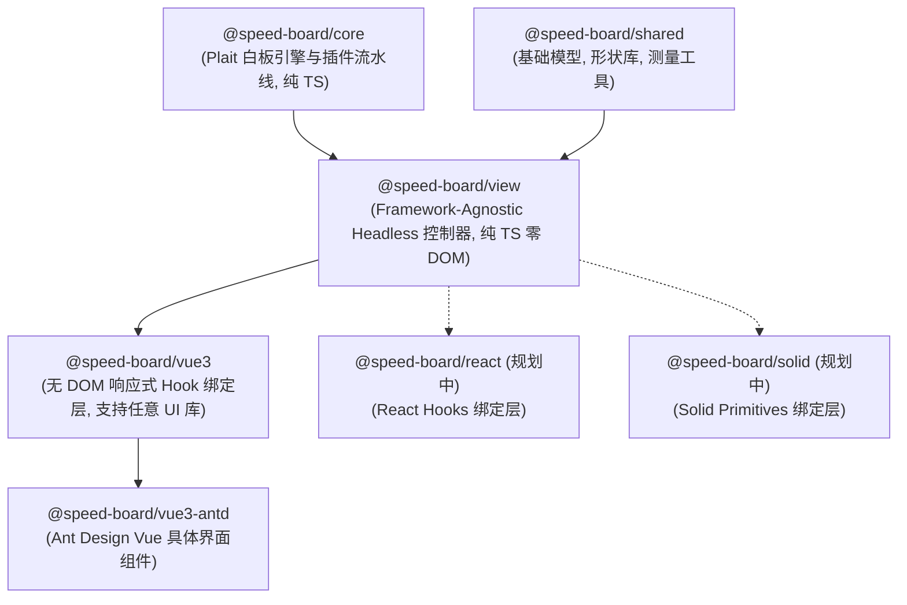

# SpeedBoard (Plait 原生白板迁移重构分支)

> 本分支（`feat/plait-migration`）记录了 SpeedBoard 彻底淘汰旧版 `@antv/x6` 架构，全面切换至现代原生白板引擎 **Plait**，并落地面向多框架（Vue 3 / React / Solid）的工业级无头分层体系的全过程。

[](https://github.com/whateveryoudo/speed-board/tree/feat/plait-migration)
[](https://opensource.org/licenses/MIT)

---

## 💥 为什么必须迁移？（放弃 X6 全面拥抱 Plait 的根本动机）

在过去，SpeedBoard 采用 `@antv/x6` 作为底座，但随着白板功能深入，X6 暴露了无法调和的底层定位冲突：

| 维度 / 痛点 | 旧版 (@antv/x6 方案) | 新版 (Plait 原生白板方案) | 业务价值 |
| :--- | :--- | :--- | :--- |
| **产品定位** | **拓扑图/流程图引擎**<br/>本质为有向无环图（DAG）设计，擅长连线拓扑，不适应大白板自由交互 | **真正的工业级协同白板引擎**<br/>专为无界自由画布打造，天然契合图形、思维导图、手绘自由混排 | 体验从“画流程图”质变为“现代化在线白板” |
| **渲染机制** | **重型 DOM 外挂 + `<foreignObject>`**<br/>节点大量依赖 HTML 容器外挂，画布缩放平移时产生亚像素抖动与层级闪烁 | **100% 纯原生 SVG Viewport 渲染**<br/>所有图元统一在单一 SVG 视口变换矩阵中绘制，零 DOM 外挂，缩放丝滑无损 | 渲染性能提升数倍，彻底杜绝浮层错位 |
| **文本与内联编辑** | **割裂的外挂 input/textarea**<br/>双击编辑时动态叠加 HTML 元素，光标选区与节点属性分离，撤销重做无法原子化 | **原生 Slate.js 富文本原子集成**<br/>文字排版、光标、样式变更与节点本身数据流完全合一 | 原生富文本输入体验，支持细粒度排版与协同 |
| **思维导图与手绘** | **外置繁琐重算**<br/>脑图结构切换需自行编写全量 recalculate；画笔受限于 SVG Path 更新，性能低 | **核心内置专用排版流水线**<br/>导图支持向右/标准/鱼骨图等原生布局；手绘内置 Catmull-Rom 平滑拟合 | 脑图拖拽排版与画笔绘制流畅顺手 |
| **依赖包袱** | **臃肿庞大**<br/>引入 230+ 个 X6 插件与兼容垫片，技术债务累累 | **纯净轻量**<br/>移除全部 230+ X6 依赖包，代码结构清爽可控 | 打包体积大幅缩减，依赖关系清晰健康 |

---

## 🎯 关键底层缺陷深度攻坚：为什么图形老是选不中、只有点边框或框选才行？

在迁移过程中，我们定位并彻底攻克了一个困扰已久的体验痛点：**“为什么在画布画了个图形，点击图形中间毫无反应，只有点在 4px 的极细边框线上或者框选才能选中？”**

### 1. 官方源码的“中空穿透”理念
查阅 Plait 官方核心源码 [`packages/draw/src/utils/hit.ts`](https://github.com/worktile/plait/blob/develop/packages/draw/src/utils/hit.ts#L217-L230)：
```ts
export const isHitDrawElement = (board, element, point, isStrict = true) => {
    // 1. 优先检测是否点中 4~5px 的边框边缘
    if (isHitEdgeOfShape(board, element, point, HIT_DISTANCE_BUFFER)) {
        return true;  // <--- 点边框能中
    }
    
    // 2. 关键设计：在严格拾取模式下，没有文字且没有填充颜色的图形
    if (!!isStrict && isEmptyTextElement(element) && !isFilledDrawElement(board, element)) {
        return false; // <--- 只要点在图形内部空白处，底层直接拦截返回 false！
    }

    const engine = getEngine(getElementShape(element));
    return isHitText || engine.isInsidePoint(rectangle!, point);
};
```
在 Plait 核心接口中，作者甚至专门写了一条注释声明：
> `// When the element has no fill color, it is considered a hit only if it hits the border.`

官方作者沿袭了传统 CAD / Illustrator 的假设：认为无填充、无文字的图形是“中空透明线框”，点中间应该穿透去选背后的东西。但这在白板交互中极其反人类——**正常用户拖出一个矩形，本能就是随手点图形正中心，谁会小心翼翼用鼠标对准 4px 细线点？**

### 2. 富文本未挂载时序 NPE Bug
在刚创建图形时，`isEmptyTextElement` 内部调用 `editor.children[0]`。由于 Slate 文本编辑器尚未挂载到全局 WeakMap，直接抛出 `Cannot read properties of undefined (reading 'children')`，被外层 `catch` 吞并后判定为未击中。

### 3. 为什么框选又能中？
框选调用的是 `isRectangleHitDrawElement`，走的是包围盒相交检测，**完全不走严格模式，也不在乎是否有填充色或文字**，碰上就中！

### 4. 我们的解决方案：`withHitEnhance` 增强插件
我们在核心层中编写了切片拦截：
- 捕获并防御底层未初始化 NPE 异常；
- 当底层因“无填充无文字”直接返回 `false` 时，调用 Plait 原生的闭合多边形几何算法 `board.isInsidePoint(element, point)`；
- 无论图形是否填色、是否有字，**只要点击点落在闭合几何轮廓内部，均立即判定为命中**，彻底解决了“必须瞄准边框点击”的反直觉问题！

---

## 🏗️ 全新无头分层架构（Headless Multi-Framework）

SpeedBoard 放弃了过去组件与业务混杂的做法，建立起清晰可扩展的分层体系：



### 包职责划分

| 包名 | 职责定位 | 技术特征 |
| :--- | :--- | :--- |
| **`@speed-board/shared`** | 公共数据契约与几何资源库 | 纯 TS、零依赖，包含 20+ 矢量图形库、文字测量工具、调色盘 |
| **`@speed-board/core`** | Plait 引擎调度与流水线集成 | 纯 TS、零 DOM，封装 `Board` 门面实例，挂载 `withHitEnhance`、`withMind` 等插件 |
| **`@speed-board/view`** | **跨框架无头交互业务控制器** | **纯 TS、零 DOM、零 UI 框架依赖**。包含悬浮工具栏计算、连线控制、导图操作、样式提取与撤销重做控制器，**未来直接复用于 React 和 Solid** |
| **`@speed-board/vue3`** | **无 DOM 的 Vue 3 响应式 Hook 绑定层** | 仅依赖 Vue 3 Composition API，**零 Ant Design 依赖**。提供 `useBoard`、`useFloatingToolbar`、`useLineOperations`、`useNodeStyle` 等极薄 Hooks 及纯 SVG 宿主组件 `BoardCanvas.vue` |
| **`@speed-board/vue3-antd`**| Ant Design Vue 完整界面组件库 | 具体视觉呈现层，包含 `SpeedBoard`、`TopToolbar`、`LeftToolbar`、`FloatingToolbar`、`StyleSettingsPanel` |

---

## 🧭 底层与优秀开源参考指引

在二次开发与深入调试时，强烈推荐参考以下两份优秀的开源仓库：

1. 核心底座引擎：**[Plait (https://github.com/worktile/plait)](https://github.com/worktile/plait)**
   - 本地源码路径：`/Volumes/ykxDrive/gitee/speed-platform/plait`
   - 参考要点：Immer 不可变数据流、Transforms 变换流水线、多边形几何相交算法、WeakMap 节点映射。
2. 工业级白板实现：**[Drawnix (https://github.com/plait-board/drawnix/tree/develop)](https://github.com/plait-board/drawnix/tree/develop)**
   - 本地源码路径：`/Volumes/ykxDrive/gitee/speed-platform/drawnix`
   - 参考要点：手绘笔刷 Catmull-Rom 平滑拟合、悬浮工具栏属性提取标准、富文本深度绑定。

---

## 🚀 快速开始

```bash
# 1. 安装工作区依赖
pnpm install

# 2. 启动 Vite 开发调试服务 (运行在 http://localhost:5176/)
pnpm dev

# 3. 构建发布
pnpm build
```

---

## 📚 详细文档索引

- 📋 [**MIGRATION_SUMMARY.md**](./MIGRATION_SUMMARY.md)：迁移变动复盘、各类技术踩坑与攻坚细节全记录。
- 📐 [**ARCHITECTURE.md**](./ARCHITECTURE.md)：全新分层架构设计准则与多框架扩展指南。
- 🧭 [**REFERENCES.md**](./REFERENCES.md)：底层核心开源生态与 WeakMap 调试规范。
