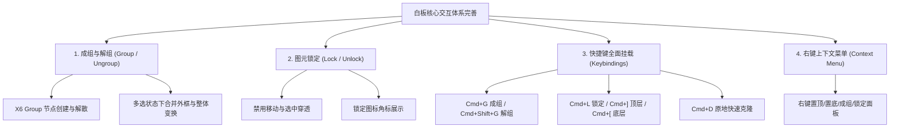

# 现代白板核心交互规范与用户操作全景手册 (SpeedBoard Guide)

> 本文档系统整理了现代专业白板（语雀白板、Figma、Miro、BoardMix）的标准交互模型、快捷键体系以及底层图形学实现机制，并作为 SpeedBoard 工具内部功能演进的技术蓝图与用户操作手册。

---

## 一、白板三维空间模型（2.5D 与图层叠放）

白板界面看似是平面的（2D），但底层图形引擎在数学上是一个 **2.5D 空间（X 横向、Y 纵向、Z 层级顺序）**。

```
                     Z 轴（谁盖住谁 / 渲染顺序 DOM Order）
                      ▲
                      │     ┌──────────────┐  [顶层图元 C] (Z=3)
                      │  ┌──┴───────────┐  │
                      │  │ [图元 B]      ├──┘  [中间图元 B] (Z=2)
                      │  │              │
                      │  └──────┬───────┘
                      │  ┌──────┴───────────────┐
                      │  │ [大背景卡片 A] (白色底) │  [底层图元 A] (Z=1)
                      │  └──────────────────────┘
                      └──────────────────────────────► X / Y 画布二维平面
```

### 为什么在您的截图里：大矩形在上面，但 `Ctrl + A` 能看到里面的线框？
正如您截图展示的现象：
1. **正常渲染状态**：当一个大矩形拥有白色背景（或不透明填充），且处于较高层级（Z-Index 大）时，它会像一张白纸直接盖在小图形上方，小图形的内容在视觉上被 100% 遮挡；
2. **选中态（Ctrl+A / 框选）**：X6 画板的选中高亮框（`.x6-widget-selection-box`）是作为**最高层级的 UI 装饰层（Overlay）** 绘制的。因此全选时，即使小图形本身被遮挡，它们的**蓝色选中外轮廓**依然会被强制透射在最上层！这非常直观地暴露了它们在底层的位置。

---

## 二、选择系统（Selection System）交互规范

选择是白板中所有排版、移动、变色操作的“前置发起动作”。

| 交互类型 | 操作方式 | 行为逻辑与规范 | 典型场景 |
| :--- | :--- | :--- | :--- |
| **单选 (Single Select)** | 鼠标左键单击图元 | 清空前序选中，聚焦当前图元，展示 8 个缩放把手与旋转手柄 | 单个图元微调、就地编辑 |
| **框选 (Rubberband)** | 鼠标在空白区域按住左键拖拽 | 生成半透明选框，与选框发生相交/包含的图元全部进入多选态 | 批量圈定区域内的所有对象 |
| **加选 (Additive Select)** | 按住 `Shift` + 单击未选图元 | 将该图元加入当前已选集合，不影响其他已被选中的图元 | 精准拾取散落在各处的多个元素 |
| **减选/反选 (Toggle Select)** | 按住 `Shift` + 单击已选图元 | 将该图元从已选集合中踢出，其余已选元素保持选中 | 大框一把全选后，剔除误选的底板 |
| **全选 (Select All)** | `Ctrl + A` / `Cmd + A` | 选中画布内所有未锁定的节点与线条 | 整体平移、统一换色、查找隐藏层 |
| **反向穿透点选** | 按住 `Ctrl / Cmd` + 单击 | 穿透顶层容器或重叠物，直接选中正下方的深层图元 | 快速选中被大底板盖住的小按钮 |

---

## 三、排版与对齐系统（Alignment & Distribution）

对齐与均分**默认在多选图元所构成的“虚拟总包围盒（Bounding Box）”内部**执行，类似于前端的 CSS Flexbox 布局模型。

```
                     总外接包围盒 (Bounding Box)
       ┌────────────────── 顶边缘 (Top) ──────────────────┐
       │                                                   │
  左边缘 (Left)         [ 图元 A ]         [ 图元 B ]      右边缘 (Right)
       │                                                   │
       │                   [ 图元 C ]                      │
       │                                                   │
       └────────────────── 底边缘 (Bottom) ────────────────┘
```

### 1. 对齐动作对照表（至少 2 个图元）
- **左对齐 (Align Left)**：所有图元的 $x = \min(x)$，紧靠包围盒左壁；
- **水平居中 (Align Center)**：所有图元的垂直中轴线移动到包围盒中心 $(\min(x) + \max(right)) / 2$；
- **右对齐 (Align Right)**：所有图元的右边缘 $x + width = \max(right)$，紧靠包围盒右壁；
- **顶对齐 (Align Top)**：所有图元的 $y = \min(y)$，紧靠包围盒天花板；
- **垂直居中 (Align Middle)**：所有图元的水平中轴线移动到包围盒中心 $(\min(y) + \max(bottom)) / 2$；
- **底对齐 (Align Bottom)**：所有图元的下边缘 $y + height = \max(bottom)$，紧靠包围盒地板。

### 2. 均分动作对照表（至少 3 个图元）
- **水平等间距均分 (Distribute Horizontally)**：两端的图元固定不动，中间所有图元的间距 $gap$ 自动均摊，实现视觉等距；
- **垂直等间距均分 (Distribute Vertically)**：最顶与最底的图元固定不动，中间各图元的垂直净空隙相等。

---

## 四、图层与空间管理（Layer Management）

| 功能名称 | 快捷键 (Mac / Win) | 功能说明 | 核心价值 |
| :--- | :--- | :--- | :--- |
| **置于顶层** | `Cmd + ]` / `Ctrl + ]` | 将选中对象直接移至所有图元之上（最大 Z-Index） | 确保关键内容永远不被遮盖 |
| **置于底层** | `Cmd + [` / `Ctrl + [` | 将选中对象直接移至所有图元之下（最小 Z-Index） | 一键将大矩形变成背景板 |
| **上移一层** | `Cmd + Alt + ]` / `Ctrl + Alt + ]` | 在同级对象中将当前对象向上提升一个层级 | 精细调整局部重叠关系 |
| **下移一层** | `Cmd + Alt + [` / `Ctrl + Alt + [` | 在同级对象中将当前对象向下沉降一个层级 | 精细调整局部重叠关系 |

---

## 五、结构化组织：成组（Group）与锁定（Lock）

### 1. 成组与解组（Group / Ungroup）
- **心智模型**：相当于前端给选中的几个单独 `<div>` 外面包裹了一个 `<div class="group-container">`；
- **交互规范**：
  - **打包成组 (`Cmd + G` / `Ctrl + G`)**：多选图元后成组，多个离散的蓝色选框合并为一个总的外接选框，带 8 个缩放把手与旋转手柄。拖动时内部所有图元保持相对坐标不变，旋转/缩放时整体联动！
  - **解散分组 (`Cmd + Shift + G` / `Ctrl + Shift + G`)**：还原成独立的离散节点。
  - **组内单选 (Double Click Into Group)**：双击组内某个子图元，可以直接单独编辑该图元的样式或文本，无需解组。

### 2. 锁定与解锁（Lock / Unlock）
- **心智模型**：给图元打上“水泥桩”，将其固定在背景层；
- **交互规范**：
  - **锁定 (`Cmd + L` / `Ctrl + L`)**：锁定后的图元无法被鼠标左键框选、无法直接拖拽位移；
  - **核心价值**：用户在底板上拉框框选内容时，**锁定的底板完全透明豁免**，只会选到浮在它上方的内容！

---

## 六、专业白板全键盘快捷键速查清单

| 功能类别 | 快捷键 (Mac) | 快捷键 (Win) | 说明 |
| :--- | :--- | :--- | :--- |
| **基础操作** | `Space + 拖拽` | `Space + 拖拽` | 临时激活平移抓手移动画布 |
| | `Cmd + 滚轮` | `Ctrl + 滚轮` | 以鼠标为中心缩放画布 (Zoom) |
| | `Cmd + A` | `Ctrl + A` | 全选所有图元 |
| | `Delete / Backspace`| `Delete / Backspace`| 删除选中图元 |
| **复制与重放**| `Cmd + C / Cmd + V` | `Ctrl + C / Ctrl + V` | 标准复制与粘贴 |
| | `Cmd + D` 或 `Alt + 拖拽` | `Ctrl + D` 或 `Alt + 拖拽` | 原位/偏移快速克隆图元 (Duplicate) |
| **图层调整** | `Cmd + ]` | `Ctrl + ]` | 置于顶层 |
| | `Cmd + [` | `Ctrl + [` | 置于底层 |
| | `Cmd + Alt + ]` | `Ctrl + Alt + ]` | 上移一层 |
| | `Cmd + Alt + [` | `Ctrl + Alt + [` | 下移一层 |
| **编组管理** | `Cmd + G` | `Ctrl + G` | 成组 |
| | `Cmd + Shift + G` | `Ctrl + Shift + G` | 解散成组 |
| | `Cmd + L` | `Ctrl + L` | 锁定 / 解锁切换 |
| **工具快捷切换**| `V` | `V` | 切换选择指针工具 |
| | `T` | `T` | 激活文本跟随放置模式 |
| | `Esc` | `Esc` | 取消放置/清空选中/退出编辑 |

---

## 七、SpeedBoard 内部能力演进路线

根据上述规范，SpeedBoard 工具内部计划落地的核心能力清单如下：


