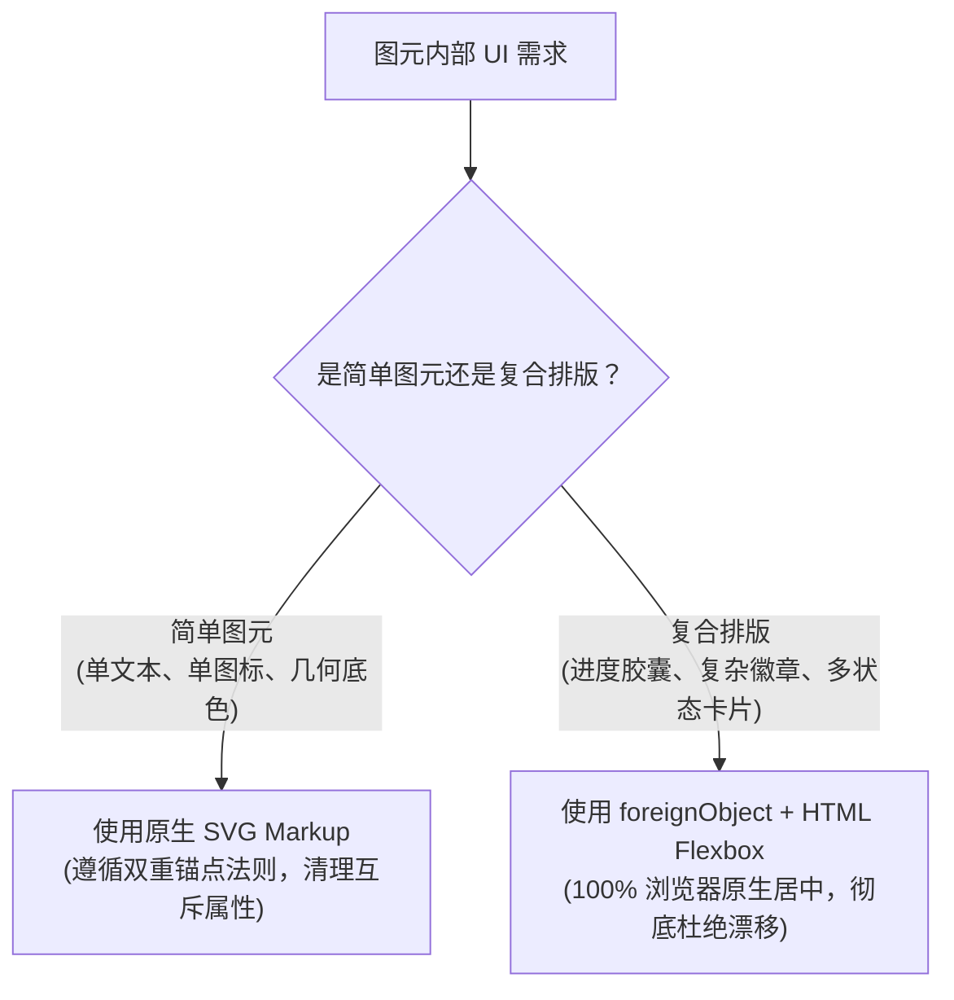
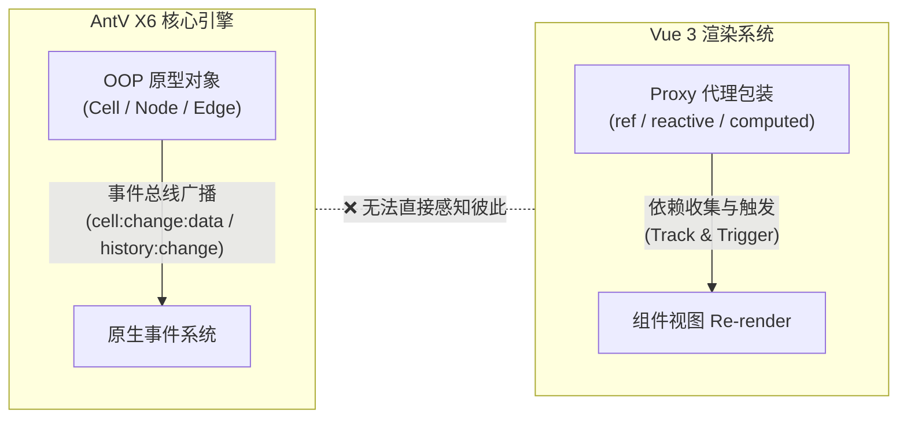

# AntV X6 坐标定位机制与图元排版避坑指南

本文档总结了在 `@speed-board` 开发过程中，针对 AntV X6 矢量画布、图元相对坐标定位、文本对齐及复合覆盖层排版的底层原理与核心避坑实践。

---

## 一、 X6 相对定位属性的底层真相

X6 提供了 `refX`, `refY`, `refDx`, `refDy`, `refX2`, `refY2` 等一系列声明式相对定位属性。由于命名容易产生误解，若不了解其底层机制极易引发**图元错位或飘出画布**。

### 1. 源码定义对比

查看 X6 源码注册表（`@antv/x6/es/registry/attr/ref.js`）：

```ts
// 1. refX / refY: 基于 reference box 的左上角原点 (origin)
export const refX = { position: positionWrapper('x', 'width', 'origin') }
export const refY = { position: positionWrapper('y', 'height', 'origin') }

// 2. refDx / refDy: 基于 reference box 的右下角顶点 (corner)!
export const refDx = { position: positionWrapper('x', 'width', 'corner') }
export const refDy = { position: positionWrapper('y', 'height', 'corner') }

// 3. refX2 / refY2: 在 refX 基础上的二次偏移 (基于 origin)
export const refX2 = refX
export const refY2 = refY
```

### 2. 核心大坑与避坑原则

| 属性组合 | 开发者直觉预期 | 实际底层运行逻辑 | 结果 |
| :--- | :--- | :--- | :--- |
| `refX: '50%'`<br>`refDx: -90` | 在中心点的基础上向左偏移 90px | `refDx` 的基准是 `corner`（右边界）。最终被计算为 `width - 90` | **直接定位到了图元右侧甚至漂移出外部** |
| `refX: '50%'`<br>`refX2: -90` | 在中心点的基础上向左偏移 90px | 正确。先算 50% 居中，再加上绝对偏移 -90px | **正确居中偏左** |

> [!IMPORTANT]
> - **切勿混用 `refX` 和 `refDx`**：`refDx / refDy` 的锚点是**右边界/下边界**（用于居右、右下角吸附等场景）。
> - **微调偏移请使用 `refX2 / refY2`**，或者在 `text` 标签上使用 SVG 原生 `dx / dy`。

---

## 二、 图形文本（Text）双重锚点对齐机制

在设置图元内文字对齐（居左 / 居中 / 居右）时，文字飘移或切换无效通常是因为**只更新了单侧属性**或**残留属性冲突**。

### 1. 双重锚点法则
SVG 文本定位必须满足两个维度的对齐：
1. **坐标锚点（Reference Anchor）**：文本的原点在节点的什么位置（左边 12px、正中间 50%、还是右侧 -12px）；
2. **排版锚点（textAnchor）**：文字以自己的哪个点去对齐坐标（`start` 左边缘、`middle` 中心、`end` 右边缘）。

### 2. 对齐标准配置表

```ts
// 1. 居左对齐 (Left Align)
node.setAttrByPath('label/textAnchor', 'start')
node.setAttrByPath('label/refX', 12)
node.removeAttrByPath('label/refDx') // 🌟 必须显式清理 refDx，防止右下角吸附残留

// 2. 居中对齐 (Center Align)
node.setAttrByPath('label/textAnchor', 'middle')
node.setAttrByPath('label/refX', '50%')
node.removeAttrByPath('label/refDx') // 🌟 必须清理

// 3. 居右对齐 (Right Align)
node.setAttrByPath('label/textAnchor', 'end')
node.setAttrByPath('label/refDx', -12) // 从右边缘往左 12px
node.removeAttrByPath('label/refX') // 🌟 必须显式清理 refX
```

---

## 三、 SVG 原生标签限制与“散装零件”陷阱

在实现图片上传进度胶囊、复合状态提示条等需求时，最初采用“纯 SVG 散装子标签”方案曾导致严重漂移。

### 1. `<path>` 标签在 SVG 中没有 `x` / `y` 属性
- SVG 规范中，`<path>` 的位置由路径数据 `d` 或 `transform="translate(...)"` 决定，**不支持 `x` 和 `y` 属性**；
- 若在 X6 中直接对 `<path>` 设置 `refX / refY`，X6 试图写入 `x/y` 属性会被浏览器原生引擎静默忽略，导致图标永久滞留在 `(0, 0)`。

### 2. 散装零件引发 BBox 循环膨胀
若在一个 `<g>` 分组内放入多个不同相对定位的散装元素（`<rect>`, `<path>`, `<text>`）：
1. 某一个零件定位稍有偏差（比如飘到右下角，或者图标在 0,0）；
2. 父级 `<g>` 的真实包围盒（Union BBox）就会被强行拉大到原本节点的数倍；
3. 下一帧 X6 根据拉大后的 BBox 重新计算相对坐标，产生雪崩效应，整个组合 UI 直接被甩出画板。

---

## 四、 最佳工程实践与选型决策



### 1. 复杂复合排版的标准模板（`foreignObject` 方案）

在图元节点的 `markup` 中声明 `foreignObject`：

```ts
markup: [
  { tagName: 'rect', selector: 'bg' },
  { tagName: 'image', selector: 'image' },
  {
    tagName: 'foreignObject',
    selector: 'progressFo',
    children: [
      {
        ns: 'http://www.w3.org/1999/xhtml',
        tagName: 'body',
        selector: 'progressBody',
        attrs: { xmlns: 'http://www.w3.org/1999/xhtml' },
        style: {
          width: '100%',
          height: '100%',
          background: 'transparent',
          margin: '0',
          padding: '0',
          overflow: 'hidden',
        },
        children: [
          {
            tagName: 'div',
            selector: 'progressContent',
            style: { width: '100%', height: '100%', margin: '0', padding: '0' },
          },
        ],
      },
    ],
  },
  { tagName: 'text', selector: 'label' },
]
```

在 `attrs` 中铺满图元：
```ts
attrs: {
  progressFo: {
    refWidth: '100%',
    refHeight: '100%',
    x: 0,
    y: 0,
    style: { display: 'none', pointerEvents: 'none' },
  },
}
```

在运行时通过 Flexbox 动态更新 HTML 内容：
```ts
// 内部使用 display: flex; align-items: center; justify-content: center;
// 彻底交由浏览器排版引擎在亚像素级计算居中，无论怎么缩放平移，永远精准居中！
node.setAttrByPath('progressContent/html', `
  <div style="width: 100%; height: 100%; display: flex; align-items: center; justify-content: center; position: relative;">
    <div style="position: absolute; inset: 0; background: rgba(0,0,0,0.38);"></div>
    <div style="position: relative; z-index: 10; display: inline-flex; align-items: center; background: #fff; border-radius: 16px; padding: 4px 12px; gap: 8px;">
      <!-- Logo、进度条、状态图标在 Flex 流中自动对齐 -->
    </div>
  </div>
`)
```

---

## 五、 X6 外部事件模型与 Vue 3 响应式系统同步避坑（核心架构）

在复杂的白板项目中，**X6 的图形对象模型与 Vue 3 的响应式追踪系统处于两个完全不同的世界**。如果混用或误解，会频发“前进后退按钮一直置灰”、“状态变了但界面死活不更新”或“控制台死循环报错”。

### 1. 两个世界的本质冲突



- **X6**：命令式面向对象，数据存储在原生 JavaScript 对象原型中，状态变更是通过**事件总线（Event Bus）**通知；
- **Vue 3**：声明式响应式框架，必须通过访问 **ES6 Proxy 对象的 getter** 才能收集依赖并触发视图更新。

---

### 2. 两大反模式陷阱

#### 陷阱一：直接在 Vue `computed` 中读取 `cell.getData()` 或 `graph.getSelectedCells()`
```ts
// ❌ 错误示范：界面不会自动响应！
const imageStatus = computed(() => {
  const cells = props.board?.graph.getSelectedCells() || []
  return cells[0]?.getData()?.status // X6 的 getData 不是 Vue Proxy，Vue 根本收集不到任何依赖！
})
```
- **后果**：即使画板上的图片节点已经从 `uploading` 变成了 `success`，或者历史记录发生了前进后退，Vue 的 `computed` **永远不会重新计算**，导致 UI（如浮层状态、Undo/Redo 按钮）卡在旧状态。

#### 陷阱二：千万不要用 Vue `ref()` / `reactive()` 深度代理 X6 Graph 或 Cell 实例！
```ts
// ❌ 灾难示范：严禁 deep proxy！
const myGraph = ref(new Graph({ ... })) // 毁灭性错误
const activeCell = reactive(selectedCell)
```
- **后果**：
  1. Vue 的响应式代理会递归将 X6 内部的 Map、WeakMap、View 缓存、Event Emitter 全部包装成 `Proxy`；
  2. 破坏对象引用唯一性（`proxyCell !== rawCell`），X6 内部在查找 View 或对比 `this.cell === targetCell` 时全线失效；
  3. 导致事件无法触发、内存泄漏甚至调用栈溢出（Maximum call stack size exceeded）。

---

### 3. 正确架构：事件驱动转换器模式（Bridge Pattern）

对齐专业编辑器（如 `editor.useAttributes`），我们构建了通用 Hook，将 X6 事件实时桥接转化为纯净轻量的 Vue `ref`：

#### A. 状态消费端（类似 `useCellAttributes`）
```ts
/**
 * 桥接器原理：通过监听 X6 事件，把数据实时同步到轻量 Vue Ref
 */
export function useCellAttributes<T>(
  boardRef: () => Board | null,
  key: string,
  defaultValue: T
): Ref<T> {
  const attrValue = ref<T>(defaultValue) as Ref<T>

  const update = () => {
    const board = boardRef()
    if (!board) return
    const cells = board.graph.getSelectedCells()
    if (cells.length === 1) {
      const data = cells[0].getData() || {}
      attrValue.value = data[key] ?? defaultValue
    } else {
      attrValue.value = defaultValue
    }
  }

  // 监听 X6 关键事件更新 Ref
  useBoardEvent(boardRef, [
    'cell:selected',
    'cell:unselected',
    'cell:change:data',
    'node:change:data'
  ], update)

  return attrValue
}
```

#### B. 实例持有原则
- `boardInstance` 与 `graph` 保持原生引用，使用 `shallowRef` 或普通局部变量存储：
```ts
// ✅ 正确做法：只用 shallowRef 存储顶层 Board 指针，不递归代理内部内部原型
const boardInstance = shallowRef<Board | null>(null)
```

#### C. 同步总结清单
1. **撤销/重做（Undo/Redo）置灰状态**：必须监听 `history:change`、`history:undo`、`history:redo`，在回调里更新 `canUndo.value` 和 `canRedo.value`；
2. **多选/单选工具条展示**：必须监听 `selection:changed`、`cell:selected`、`cell:unselected`；
3. **节点图元业务数据（如 status、fill、stroke）**：必须监听 `cell:change:data` 和 `node:change:data`，把新数据拷入 Vue `ref`，供组件模板安全绑定！

