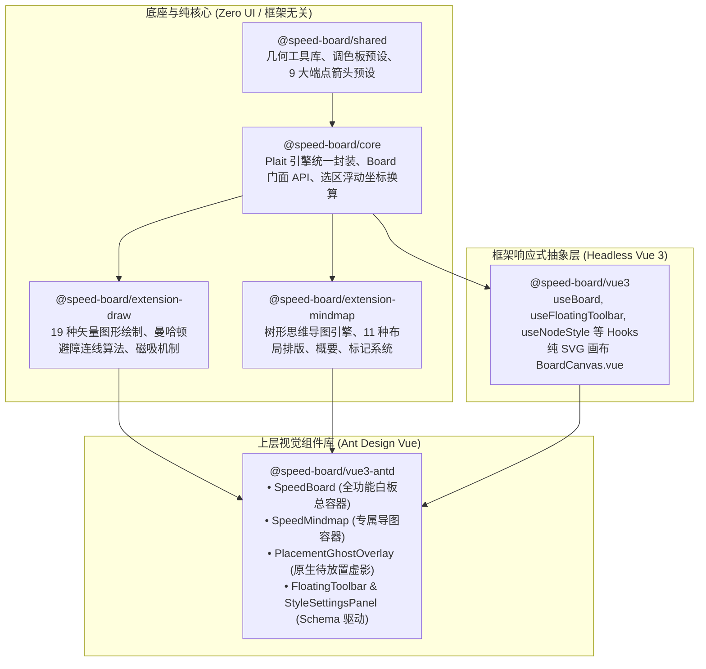

# 分层架构与核心算法

本章节深入解析 SpeedBoard 的内部架构分层与关键算法设计。

---

## 1. Monorepo 模块分层体系

项目采用分层清晰的 Monorepo 架构（基于 pnpm workspace），实现了纯底层算法、无头框架抽象与上层 UI 表现的深度解耦：

---

## 2. 核心架构亮点：Schema 驱动与 Tree-Shaking 隔离

很多白板项目随着图形与面板扩增，代码极其臃肿且难以维护。SpeedBoard 实现了纯粹的 **Schema 驱动体系**：

- **选区气泡栏与右侧抽屉动态装配**：
  浮动工具栏 `FloatingToolbar` 与样式抽屉 `StyleSettingsPanel` 均不硬编码具体业务，而是根据选区当前图元的 `selectedType` 自动装配操作项与抽屉面板；
- **宿主 Tree-Shaking 隔离保证**：
  - `FloatingToolbar` 与 `StyleSettingsPanel` 仅负责通用排版、色盘与文本交互，**完全不引入 `@speed-board/extension-draw` 沉重的白板绘图库**；
  - 白板的 19+ 种图形算法仅在 `SpeedBoard` 中按需装载；
  - **宿主若仅使用 `SpeedMindmap`，打包工具（Vite / Webpack / Rollup）能够安全、彻底地将白板绘图库 Tree-shake 剔除**，保证思维导图专属文档的轻量级加载。

---

## 3. 核心交互突破：1:1 Plait 原生待放置虚影 (PlacementGhostOverlay)

在白板中从左侧拖放/点击图形或脑图时，传统前端常见做法是手写一个 HTML `
` 模拟虚影，但极易带来样式割裂：
- 视口缩放时边框过粗或模糊；
- 菱形、平行四边形带有外部矩形白底或阴影；
- 鼠标松开落地瞬间产生图元跳跃与抖动。

**SpeedBoard 解决方案**：
直接在悬浮层中调用 Plait 底层绘图指令 `drawGeometry(props.board.raw, rectangle, pointer, ...)`，以实际落地的几何算法 1:1 原位绘制预览。
同时引入 `isDropped` 防重锁，在鼠标松开瞬间立即静默隐去虚影，实现顺滑的“所见即所得”落地交互。

---

## 4. 闭合图元中空穿透点击优化 (`withHitEnhance`)

官方 Plait 沿用了传统 CAD 理念：*没有填充颜色和文本的闭合图元被视作透明线框，点击图形内部空白处会被直接穿透忽略*。这导致用户必须极其痛苦地用鼠标对准 4px 的细线才能选中。

我们在核心层挂载了 `withHitEnhance` 增强插件，通过多边形点包含算法拦截，只要鼠标点击落在几何轮廓腹地内部，无论填色与否均秒级精准命中。

---

## 5. 智能连线正交避障 (Manhattan Router)

告别了旧版 `@antv/x6` 中脆弱且易发生折返死结的外挂曼哈顿算法。
底层内置专用 `generateElbowLineRoute` 与 `simplifyOrthogonalPoints` 算法，在图元拖拽、缩放、旋转时，正交折线自动进行矩形绕障计算并化简冗余折点，始终维持工整的 90° 直角工程制图质感。
